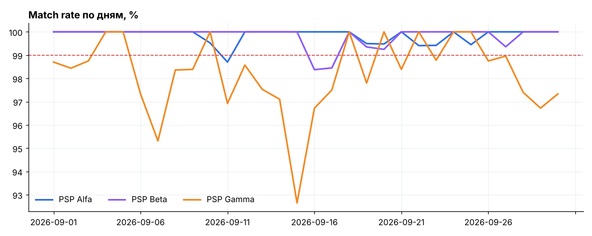
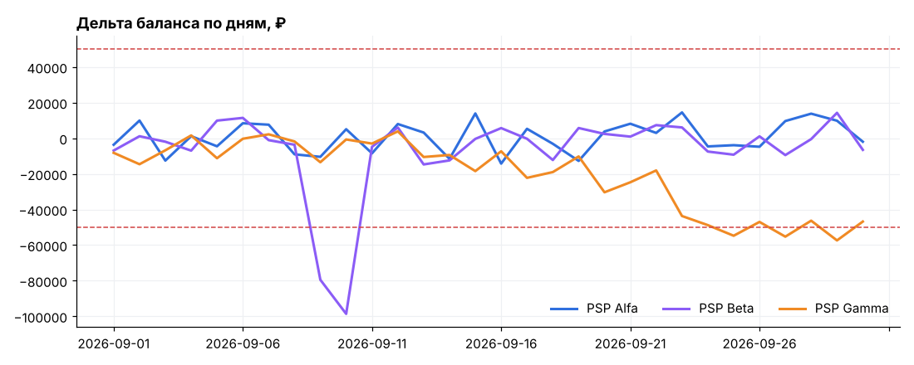

# Сверка платежей с PSP: SQL, pandas, Google Sheets

Pet-проект на синтетических данных. Модель повторяет ежедневную работу платёжной команды российского онлайн-букмекера: депозиты и выводы игроков через три платёжных провайдера (PSP) за сентябрь 2026. Суммы в рублях, названия PSP условные. Задачи и логика сверки взяты из моей работы со сверками эквайринговых и платёжных транзакций в банке.

**Дашборды в Google Sheets:** [открыть таблицу](ССЫЛКА_НА_GOOGLE_SHEETS) · исходный файл [`sheets/psp_dashboards.xlsx`](sheets/psp_dashboards.xlsx)



## Что внутри

| Задача | Как решаю | Где смотреть |
|---|---|---|
| Качество данных до сверки | Дубли `txn_id`, пропуски, некорректные суммы — до того, как данные попадут в отчёт | [ноутбук, раздел 1](notebooks/psp_reconciliation.ipynb) |
| Сверка учёта с отчётами PSP | FULL OUTER JOIN по ID транзакции, классификация: статус, сумма, комиссия, нет у PSP, нет в учёте | [`sql/reconciliation.sql`](sql/reconciliation.sql) |
| Журнал расхождений | Каждое расхождение: тип, сумма, причина, статус разбора | [`data/breaks_log.csv`](data/breaks_log.csv), лист «Журнал» |
| Match rate по PSP и по дням | Доля сверенных транзакций, дни ниже порога 99% | лист «Сверка», раздел 2 ноутбука |
| Контроль балансов на PSP | Ожидаемый баланс по учёту против выписки, порог эскалации 50 000 ₽, сигнал тренда | лист «Балансы», [`sql/summary.sql`](sql/summary.sql) |
| Отчёт для трейдеров | Оборот, доля успешных платежей, эффективная комиссия по PSP, регионам и неделям | лист «Платёжный отчёт», раздел 4 ноутбука |

## Главные результаты

- **11 738 транзакций**, **53 расхождения**, общий match rate **99,55%**. На конец месяца открыты 7 расхождений на 56 112 ₽.
- **PSP Gamma** даёт 38 из 53 расхождений при самом маленьком объёме, match rate 98,25% против 99,8% у остальных. Пик 14–17 сентября.
- **Балансы:** у PSP Beta разовый провал 9–10 сентября до −98 636 ₽ (задержка зачисления, на следующий день дельта вернулась к норме). У PSP Gamma с 14 сентября дельта ни разу не выходила в плюс: средняя углубилась с −17 700 ₽ (14–21 сентября) до −46 442 ₽ (22–30 сентября), минимум −57 379 ₽. По времени совпадает со всплеском расхождений по комиссиям.
- **Стоимость провайдеров:** эффективная комиссия PSP Alfa 1,87%, PSP Gamma 2,99%, то есть Gamma дороже почти в 1,6 раза. У Gamma отклоняется каждый пятый платёж (80,2% успешных против 91,9% у Alfa).
- **Регионы:** за пределами Москвы и Петербурга доля успешных платежей ниже — 84,5% против ~89%. Провал есть у всех трёх PSP, значит причина не в провайдере.

| PSP | Успешные, % | Оборот, ₽ | Комиссии, ₽ | Эффективная комиссия |
|---|---|---|---|---|
| PSP Alfa | 91,9 | 63 081 038 | 1 178 920 | 1,87% |
| PSP Beta | 86,5 | 39 027 381 | 915 708 | 2,35% |
| PSP Gamma | 80,2 | 22 017 250 | 659 256 | 2,99% |



## Дашборды в Google Sheets

Все показатели на листах «Сверка», «Балансы» и «Платёжный отчёт» считаются формулами таблицы (SUMIFS, COUNTIFS, IFERROR, OFFSET), а не вставлены значениями. Желтые ячейки — фильтры и пороги: меняете PSP, регион или порог эскалации, и пересчитывается всё, включая графики и условное форматирование. Исходные данные лежат на листах `data_*`.

## Структура

```
data/                   CSV: ledger, psp_report, balances, payments_weekly, breaks_log
sql/reconciliation.sql  сверка учёта с отчётами PSP
sql/summary.sql         сводные запросы: match rate, типы расхождений, балансы, комиссии
notebooks/              ноутбук с анализом и графиками
charts/                 графики из ноутбука
sheets/                 книга с дашбордами для Google Sheets
src/generate_data.py    генерация синтетических данных (детерминированно)
src/build_notebook.py   сборка ноутбука
src/build_sheets.py     выгрузка данных в книгу и сборка дашбордов на формулах
```

## Как запустить

```bash
pip install -r requirements.txt
python src/generate_data.py      # пересоздать CSV
python src/build_sheets.py       # пересобрать книгу для Google Sheets
jupyter notebook notebooks/psp_reconciliation.ipynb
```

SQL написан для SQLite 3.39+ (нужен FULL OUTER JOIN) и без изменений работает в PostgreSQL.

## Стек

SQL · Python (pandas, matplotlib) · Jupyter · Google Sheets / Excel

---

**Егор Епифанов** · аналитик данных, сверки и финансовая отчётность · Белград
[Telegram](https://t.me/pretty_rom) · egorka.epifanov.2k17@gmail.com
